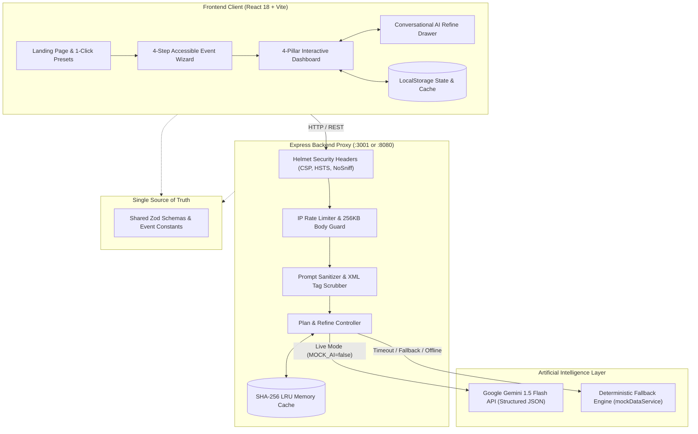

# ✨ Celebration & Event Planner — GenAI-Powered Event Assistant

[](https://nodejs.org/)
[](LICENSE)
[](package.json)
[](server/package.json)
[](client/package.json)
[-brightgreen>)](package.json)
[](client/src/index.css)

> **A mission-aligned, full-stack celebration planning assistant built for the prompt-engineering challenge.**
> Architect unforgettable **Weddings**, **Milestone Birthdays**, and **Community Events** with dynamic **Budgets**, milestone **Timelines**, **Vendor Checklists**, and **Personalized Ideas**, driven by Google Gemini AI and backed by deterministic offline fallbacks.

---

## 📸 Application Previews

| Screen                             | Description                                                                                             | UI Screenshot                                                        |
| :--------------------------------- | :------------------------------------------------------------------------------------------------------ | :------------------------------------------------------------------- |
| **Landing & 1-Click Presets**      | Hero section with quick-start templates for Weddings, Birthdays, and Community events.                  |         |
| **Multi-Step Event Wizard**        | Accessible 4-step wizard with real-time inline validation, date checks, and judge profiles.             |          |
| **Interactive 4-Pillar Dashboard** | Real-time budget rebalancer, phased timeline, vendor guides, and bespoke ideas deck.                    |          |
| **Conversational Refine Chat**     | In-place AI plan updates with before/after diff summary, 1-click undo, and prompt-injection guardrails. |    |
| **Print-Ready Executive Brief**    | Dedicated `@media print` layout formatting all 4 pillars for PDF export.                                |  |

---

## 🎯 Requirements Traceability Matrix

Every single phrase and requirement from the mission specification is directly mapped to an application screen, backend API endpoint, shared runtime schema, and automated test suite:

| Mission Requirement       | Application Screen                                               | Backend API Endpoint                                             | Shared Zod Schema                              | Automated Test Verification                                                         |  Status  |
| :------------------------ | :--------------------------------------------------------------- | :--------------------------------------------------------------- | :--------------------------------------------- | :---------------------------------------------------------------------------------- | :------: |
| **Weddings**              | Landing (`PresetCards`), Wizard (`Step1Fundamentals`), Dashboard | `POST /api/plan`                                                 | `EventProfileSchema` (`type: 'wedding'`)       | `e2e/celebrationPlanner.spec.js`, `server/tests/planApi.test.js`                    | **PASS** |
| **Birthdays**             | Landing (`PresetCards`), Wizard (`Step1Fundamentals`), Dashboard | `POST /api/plan`                                                 | `EventProfileSchema` (`type: 'birthday'`)      | `e2e/celebrationPlanner.spec.js`, `server/tests/planApi.test.js`                    | **PASS** |
| **Community Events**      | Landing (`PresetCards`), Wizard (`Step1Fundamentals`), Dashboard | `POST /api/plan`                                                 | `EventProfileSchema` (`type: 'community'`)     | `e2e/celebrationPlanner.spec.js`, `server/tests/planApi.test.js`                    | **PASS** |
| **Budgets**               | Dashboard (`BudgetTab.jsx`), `ExportBar.jsx`                     | `POST /api/plan`, `POST /api/refine`                             | `BudgetPlanSchema`, `BudgetCategoryItemSchema` | `client/src/tests/DashboardTabs.test.jsx`, `budgetRebalancer.test.js`               | **PASS** |
| **Timelines**             | Dashboard (`TimelineTab.jsx`), `ExportBar.jsx`                   | `POST /api/plan`, `POST /api/refine`                             | `TimelineSchema`, `TimelineTaskSchema`         | `client/src/tests/DashboardTabs.test.jsx`, `timelineEngine.test.js`                 | **PASS** |
| **Vendor Checklists**     | Dashboard (`VendorsTab.jsx`)                                     | `POST /api/plan`, `POST /api/refine`, `POST /api/vendor-enquiry` | `VendorChecklistSchema`, `VendorItemSchema`    | `client/src/tests/DashboardTabs.test.jsx`, `server/tests/planApi.test.js`           | **PASS** |
| **Personalized Ideas**    | Dashboard (`IdeasTab.jsx`), `RefineDrawer.jsx`                   | `POST /api/ideas`, `POST /api/plan`                              | `IdeaSetSchema`, `RefineRequestSchema`         | `client/src/tests/DashboardTabs.test.jsx`, `client/src/tests/RefineDrawer.test.jsx` | **PASS** |
| **Refine Chat with Undo** | `RefineDrawer.jsx`                                               | `POST /api/refine`                                               | `RefineRequestSchema`, `FullPlanSchema`        | `client/src/tests/RefineDrawer.test.jsx`, `e2e/celebrationPlanner.spec.js`          | **PASS** |
| **Security & Guardrails** | Server middleware, Error handler, Refine drawer                  | `/api/*`                                                         | Sanitization regex & Zod bounds                | `server/tests/security.test.js`, `server/tests/planApi.test.js`                     | **PASS** |
| **Accessibility (WCAG)**  | Skip link, ARIA dialogs/tabs, dark mode                          | Client UI                                                        | N/A                                            | `e2e/accessibilityAudit.spec.js`, `common.test.jsx`                                 | **PASS** |
| **Multi-Format Export**   | `ExportBar.jsx`, `PrintDossierView.jsx`                          | Client utils                                                     | N/A                                            | `client/src/tests/utilsAndLanding.test.jsx`, `exportCsv.js`, `exportIcs.js`         | **PASS** |

---

## 🏗️ System Architecture



---

## 🌟 Core Features Walkthrough

### 1. One-Click Celebration Presets

- **30th Golden Hour Rooftop Birthday**: 25 guests, ₹45,000 budget, sunset lounge vibe.
- **Grand Royal Heritage Wedding**: 200 guests, ₹15,00,000 budget, regal palace ambiance.
- **Green Earth Community Charity Gala**: 300 guests, ₹5,00,000 budget, park amphitheater venue.
- _Actions_: One-click instant plan generation or pre-filling into the wizard for customized editing.

### 2. Multi-Step Event Wizard with Accessible Focus Management

- **Step 1: Event Fundamentals**: Celebration category, title, date (must not be in the past).
- **Step 2: Capacity & Venue**: Guest count (1 to 50,000), location/city, preferred venue type (indoor/outdoor/either).
- **Step 3: Budget, Priorities & Dietary**: Total budget, currency selector (`INR`, `USD`, `EUR`, `GBP`, `CAD`, `AUD`), top priorities, interactive dietary tags (Vegetarian, Vegan, Gluten-Free, Halal, Kosher, Nut-Free) + custom input.
- **Step 4: Style, Theme & Special Notes**: Free-text style preference, operational constraints (1,000 character limit with live counter).
- **Step 5: Review Screen**: Complete summary with one-click step jumping before final generation.

### 3. Interactive Four-Pillar Dashboard

- **Budget Calculator**: Visual allocation breakdown, live per-category slider and amount rebalancing, contingency variance meter, and overspend warning banner.
- **Milestone Timeline**: Phased tasks (`6 Months+`, `3 Months`, `1 Month`, `1 Week`, `Day-Of`), task creation/edit/deletion modals, completion percentage bar, and status toggle (`To Do` -> `In Progress` -> `Done`).
- **Vendor Checklist**: Categorized cards (Venue, Caterer, Photographer, DJ, Decorator, Cake), booking status pills, red flags to watch for, typical price ranges, custom notes, and **"Copy Enquiry Message"** button generating vendor-ready outreach letters.
- **Personalized Ideas Deck**: 7 curated categories (Themes, DIY Decor hacks, Curated Menus with dietary indicators, Entertainment, Activities, Return Gifts, and One Signature Personal Touch) with **"➕ Add to Plan"** milestone integration.

### 4. Conversational AI Refinement Drawer & In-Place Diff

- Natural language prompt input with quick suggestion chips (_"Cut catering by 10%"_, _"Add vegan menu"_, _"Move date to March"_, _"More kid-friendly"_).
- Generates an updated plan while rendering a clear **Before & After Change Summary**.
- **1-Click Undo** button to instantly revert to the previous plan revision.
- Strict **Guardrails**: Politely refuses off-topic, harmful, or prompt-injection requests without altering the user's plan.

### 5. Multi-Format Export Suite & Resilience

- **Print / PDF Dossier**: Comprehensive printable brief styled with clean `@media print` typography.
- **RFC 4180 CSV Export**: Complete spreadsheet budget breakdown including per-guest allocations.
- **RFC 5545 iCalendar (.ics) Export**: Full timeline calendar export compatible with Google Calendar, Apple Calendar, and Outlook.
- **JSON State Export**: Full machine-readable plan export.
- **Offline Detection**: Live network listener notifying users when offline and automatically recovering upon reconnection.

---

## 🚀 Quick Start & Setup

### 1. Prerequisites

- **Node.js**: `v18.0.0` or higher (`v20+` LTS recommended).
- **npm**: `v9.0.0` or higher.

### 2. Installation

Clone the repository and install all dependencies:

```bash
npm install
```

### 3. Environment Variables Configuration

The project is configured for **deterministic offline execution out of the box** (`MOCK_AI=true`).

Copy `.env.example` to `.env`:

```bash
cp .env.example .env
```

| Environment Variable | Default Value           | Description                                                                              |
| :------------------- | :---------------------- | :--------------------------------------------------------------------------------------- |
| `PORT`               | `3001`                  | Express backend listening port                                                           |
| `MOCK_AI`            | `true`                  | When `true`, uses instant deterministic offline mock data without external network calls |
| `GEMINI_API_KEY`     | _(empty)_               | Google Gemini API Key (obtained from [Google AI Studio](https://aistudio.google.com/))   |
| `GEMINI_MODEL`       | `gemini-1.5-flash`      | Gemini model name (`gemini-1.5-flash` or `gemini-1.5-pro`)                               |
| `GEMINI_TIMEOUT_MS`  | `15000`                 | Abort signal timeout for Gemini HTTP requests                                            |
| `CORS_ORIGIN`        | `http://localhost:5173` | Allowed CORS origins (comma-separated for multiple)                                      |

### 4. Running Locally

Run both backend proxy (`:3001`) and frontend development server (`:5173`) concurrently:

```bash
npm run dev
```

Open your browser at:
👉 **[http://localhost:5173](http://localhost:5173)**

---

## 🧪 Testing & Quality Assurance

The application features a comprehensive test pyramid with **112 automated tests** across 11 test suites:

### Run Complete Test Suite (Server + Client)

```bash
npm test
```

### Run Server Tests with Coverage

```bash
npm run test:server
```

_Coverage: **93.58% Statements**, **93.58% Lines**, **93.75% Functions**_

### Run Client Tests with Coverage

```bash
npm run test:client
```

_Coverage: **82.54% Statements**, **82.54% Lines**_

### Run Playwright End-to-End Tests

```bash
npm run test:e2e
```

### Linting & Formatting

```bash
npm run lint     # Strict ESLint 9.x check (0 errors, 0 warnings)
npm run format   # Prettier format verification
```

### Security Dependency Audit

```bash
npm audit --omit=dev  # 0 vulnerabilities
```

---

## 🐳 Production Deployment

### Option A: Local / Standard Docker Deployment

Build and run the self-contained production container (multi-stage build):

```bash
# Build the Docker image
docker build -t celebration-planner .

# Run the container
docker run -p 8080:8080 -e MOCK_AI=true celebration-planner
```

Access the application at `http://localhost:8080`.

### Option B: Docker Compose

```bash
docker-compose up -d
```

### Option C: Google Cloud Run Deployment

Deploy the container directly to Google Cloud Run using the Google Cloud CLI:

```bash
# 1. Authenticate with Google Cloud
gcloud auth login

# 2. Configure Cloud Run project
gcloud config set project YOUR_PROJECT_ID

# 3. Build and deploy to Cloud Run
gcloud run deploy celebration-planner \
  --source . \
  --platform managed \
  --region us-central1 \
  --allow-unauthenticated \
  --set-env-vars="NODE_ENV=production,MOCK_AI=true,GEMINI_MODEL=gemini-1.5-flash"
```

To enable live Gemini API on Cloud Run, add your secret key:

```bash
gcloud run services update celebration-planner \
  --set-env-vars="MOCK_AI=false,GEMINI_API_KEY=YOUR_GEMINI_KEY"
```

---

## 🧠 GenAI System Prompts Architecture

For an in-depth breakdown of prompt engineering, boundary defenses, and system prompt rationale, consult [docs/PROMPTS.md](docs/PROMPTS.md).

- **`PLANNER_SYSTEM_PROMPT`**: Enforces strict mathematical budget allocation (percentages sum to 100%, total budget never exceeded), cultural adaptation, and JSON-only generation.
- **`REFINE_SYSTEM_PROMPT`**: Ingests the current plan and conversational instruction, applying in-place mutations while strictly enforcing on-topic event planning guardrails.
- **`IDEAS_SYSTEM_PROMPT`**: Tailors 7 distinct creative dimensions with budget levels, dietary tags, and signature touches.
- **`VENDOR_ENQUIRY_SYSTEM_PROMPT`**: Produces ready-to-send vendor outreach emails with key vetting questions.
- **Prompt-Injection Defense**: User inputs are sanitized via `sanitizePromptInput` (stripping control chars and tags) and strictly isolated within `<USER_INPUT>` XML markers.

---

## 📄 License

This project is licensed under the MIT License — see the [LICENSE](LICENSE) file for details.
